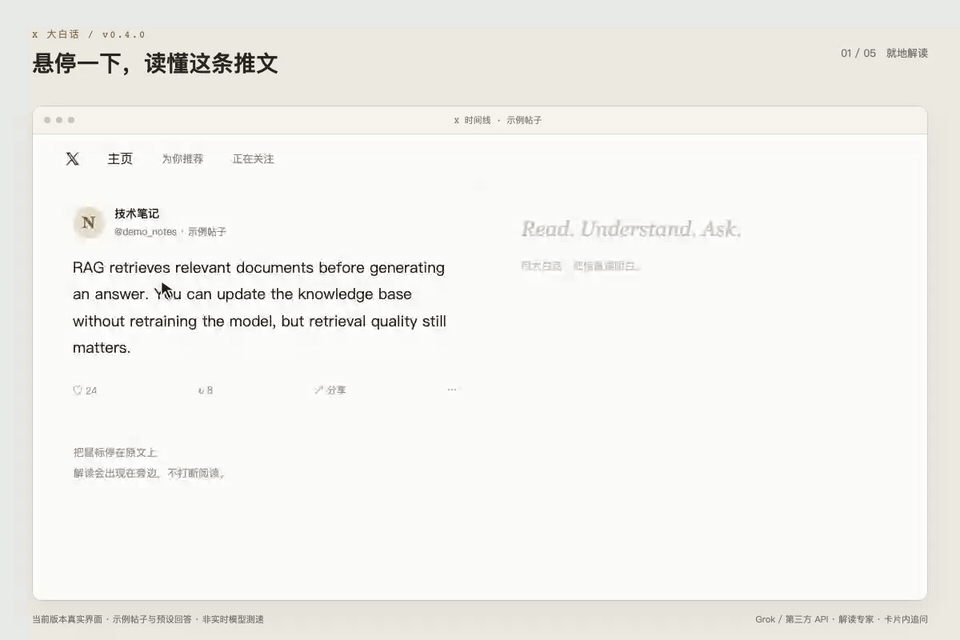

# X Dabaihua · Grok Explainer Enhancer

English · [简体中文](./README.md)

Hover any tweet or long-form **Article** on X (Twitter) and it's automatically explained in **plain, conversational Chinese** ("大白话") — rendered right there in a slick card.

<p align="center">
  
</p>

Recorded with the actual v0.4.0 interface, a sample post, and preset responses. This demonstrates the interaction flow, not live model response times.

> The clever bit: the extension **never touches any signature and stores credentials only on your machine**. It can reuse X's own already-signed Grok request, rewriting only the message into a "speak plainly" instruction before it goes out and reading back Grok's streamed answer — or it can call a third-party OpenAI-compatible API with your own key instead.

## Features

- **Hover to explain**: rest the cursor on a tweet; a progress ring fills and auto-triggers — or click the ring to fire instantly.
- **Real plain language**: hijacks X's built-in Grok "explain", rewrites that official analysis into conversational Chinese, streams it in, with citation markers `[n]`.
- **X long-form Articles supported**:
  - Article cards in the timeline — keeps X's analysis context so the backend reads the article body as usual;
  - Article detail pages (no inline Grok button) — grabs the full text from the page and drives the Grok drawer to summarize it.
- **Four modes**:
  - `grok` real plain-language (default; reuses your X session)
  - `api` third-party API — call any OpenAI-compatible endpoint with your own key
  - `demo` pure UI preview, no model call
  - `learn` learning mode, saves debugging records after capture is explicitly enabled (sensitive request headers are redacted)
- **Third-party API service registry**: presets for xAI, OpenAI, DeepSeek, OpenRouter, Groq, SiliconFlow and local Ollama; edit the URL, key, model, temperature and system prompt, or add your own service. Requests go out from the background service worker, and the target origin is authorized on demand from Settings.
- **Explanation experts**: built-in plain-language, technical breakdown, translate + explain, key points, and critique, plus a free-form custom one. Prompts follow a "scope + fidelity constraints + no fabrication" shape and support `{{text}}`, `{{url}}`, `{{author}}` and other placeholders, with a live preview in Settings. Switch experts right from the card header.
- **Follow-up questions**: ask inside the card after an explanation, with each answer appended to the conversation. Cached explanations support follow-ups too.
- **Continue in Grok**: prepares a draft in X’s native Grok input with the original post, explanation, sources, and completed turns for you to edit and send.
- **Result cache**: keyed by post + mode + expert + service, so switching experts or services never mixes results; hit "Re-explain" to force a refresh.
- **Themes**: graphite / light / ocean / neon / follow system.
- **Hide native drawer**: hides X's own Grok drawer only while explaining, keeping its native position to prevent autofocus from scrolling the timeline to the top; restores its original inline styles on completion, error, timeout, or card close.

## Install (load unpacked)

1. Clone this repo locally:
   ```bash
   git clone https://github.com/nodlles/x-grok-dabaihua.git
   ```
2. Open `chrome://extensions/` and turn on "Developer mode" (top right).
3. Click "Load unpacked" and select this repo's directory.
4. Open [x.com](https://x.com) and hover over any tweet.

> Grok mode needs a browser already logged in to X (it relies on your own session); third-party API mode uses your own key and does not. The extension declares only the `storage` permission, with required host access limited to `x.com` / `twitter.com`; API endpoints are granted on demand via `optional_host_permissions`.

## Settings

Clicking the extension icon opens a small popup that reports the current state (engine, expert, service, readiness) with a single enable switch. Use "Open full settings" there, or open "Options" from `chrome://extensions`, for the detailed configuration:

- **Basics**: on/off, mode (Grok / third-party API / demo / learn), hover delay, theme, whether to hide the native drawer, and (if auto-detection misses) a manual drawer selector.
- **Experts**: pick an expert, edit its prompt, restore the default, and preview exactly what will be sent to the model.
- **AI services**: add or remove services, set URL, API key, model, temperature and system prompt; "Save and authorize domain" requests the permission and "Test connection" sends a `ping`.

API keys live only in local `chrome.storage`; they are never sent to the developer and are not exposed by packaging or sharing.

Request capture is off by default. It requires the extension to be enabled, learning mode selected, and the capture switch enabled. Existing switch preferences are preserved, but capture is inactive in plain-language and demo modes. Up to 30 records are stored locally, including request bodies and response samples that may contain chat content. View, copy, or clear them in Settings. Check records before sharing: header redaction does not sanitize the entire record.

Closing the card, re-explaining, or changing modes stops the old task's automated clicks, waits, and card reader. Requests already sent by X may continue and consume quota; the extension does not abort X's own requests. Waiting ends after 10 seconds without an initial response or 120 seconds overall.

## Follow-up questions

- After a plain-language explanation completes, type a question and press Enter or Send. Shift+Enter inserts a newline; IME composition does not submit.
- Focusing the input pins the conversation. Hovering another post or clicking outside no longer dismisses it; use × to close.
- Each follow-up carries the original post, initial explanation, citation sources, and completed turns. A failed question is restored for editing and retry; incomplete or failed answers are excluded from subsequent context.
- Continue in Grok prepares a contextual draft without sending it or overwriting an existing native draft. Subsequent native Grok messages do not sync back into the card.
- Questions are limited to 2,000 characters and the context to 60,000 characters. Excess length produces an error rather than silently dropping context. For longer conversations, copy the relevant material into Grok.
- Follow-up history lives only in the current card’s memory. Closing the card, refreshing, or re-explaining clears it; the persistent cache still stores only the initial explanation. Follow-ups use your Grok quota.

## Development checks

Use Node.js 20 or newer; no dependencies are required:

```bash
node --test tests/*.test.cjs
```

Tests execute the actual scripts with simulated DOM, storage, and timers. They cover cancellation, drawer restoration, capture settings, streaming, follow-up context, and native draft protection. They do not replace compatibility checks against live X buttons, drawers, and APIs. After editing, reload the extension in `chrome://extensions/` and refresh X.

## Automated GitHub releases

Update the version in `manifest.json`, add the matching `## vVERSION` section to `CHANGELOG.md`, and commit and push the changes. Then push a matching stable version tag, for example:

```bash
git push origin main
git tag v0.4.1
git push origin v0.4.1
```

The Release workflow validates the version and changelog, runs tests, packages and verifies the extension, then publishes a GitHub Release with a ZIP and SHA-256 file. Uploaded assets are downloaded and compared before publishing. Failed uploads leave a draft that can be resumed by rerunning the workflow; rerunning a published release only verifies its assets. No additional token is required.

Only pushed tags trigger publication. The remote tag must still resolve to the packaged commit before publication; do not move pushed release tags, use a new version instead. Use Actions → Release → Run workflow for a build-only dry run (artifacts retained for 14 days). This workflow publishes GitHub releases; Chrome Web Store submission remains a separate process.

## How it works

| File | World | Responsibility |
|---|---|---|
| `inject.js` | MAIN | Handles current Grok WebSocket `response.create` messages and correlates streamed replies by session, request, and response IDs; retains legacy `fetch`/`add_response` support and `fetch`/`XHR` learning captures |
| `content.js` | ISOLATED | Hover progress ring, card UI, extracting tweet/article text, locating and clicking the Grok entry point, receiving main-world messages to render |
| `render.js` / `cardui.js` / `cache.js` / `card.css` | ISOLATED | Rich-text rendering, card interaction, caching, styles |
| `conversation.js` | ISOLATED | Builds contextual prompts from the post, explanation, sources, and completed turns; validates length |
| `aiconfig.js` | Shared | Pure data/functions: service registry, experts and prompt templates, shared by the content script, background worker and settings page |
| `background.js` | SW | Proxies third-party API requests (bypassing page CORS), parses SSE streams, serves the settings-page connection test |
| `theme.css` | — | Shared theme layer: colour tokens, type scale and base controls (switch, buttons) used by both the settings page and the popup |
| `popup.html` / `popup.js` | — | Toolbar popup: current state, one enable switch, and the hand-off to the settings page |
| `options.html` / `options.js` | — | Settings page |

The two worlds talk via `window.postMessage`. WebSocket requests replace the input text with the plain-language prompt and preserve the other message fields. Legacy fetch requests are rewritten as follows:
- Normal tweets (text present in the DOM) → embed the text into the prompt, switch to a plain chat message;
- Articles / image / video posts (no text in the DOM) → **keep** `promptMetadata` so X's backend supplies the body, and only append the "speak plainly" style requirement.

In third-party API mode the content script hands the `system` message and the rendered user prompt to the background service worker, which posts them with `Authorization: Bearer <your key>` to your configured `/chat/completions` endpoint and streams `delta` chunks back into the card. Follow-ups send a real multi-turn `messages` array (`system` + initial exchange + completed turns + the new question) rather than a JSON blob.

Current X Grok contenteditable inputs and legacy textareas both support follow-ups and draft handoff. After local code changes, reload the extension in your browser's extension manager and refresh X so both script worlds update. Learning-mode request capture currently covers legacy `fetch`/`XHR` only; it does not record WebSocket chats.

## Disclaimer

Unofficial third-party tool, not affiliated with X / xAI. For personal study and research only; please comply with X's Terms of Service.

## License

[MIT](./LICENSE) © 2026 nodlles
